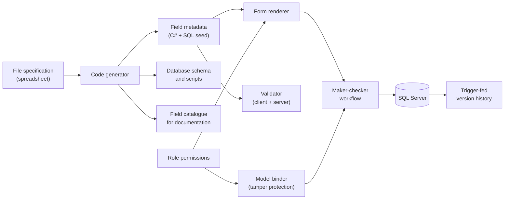
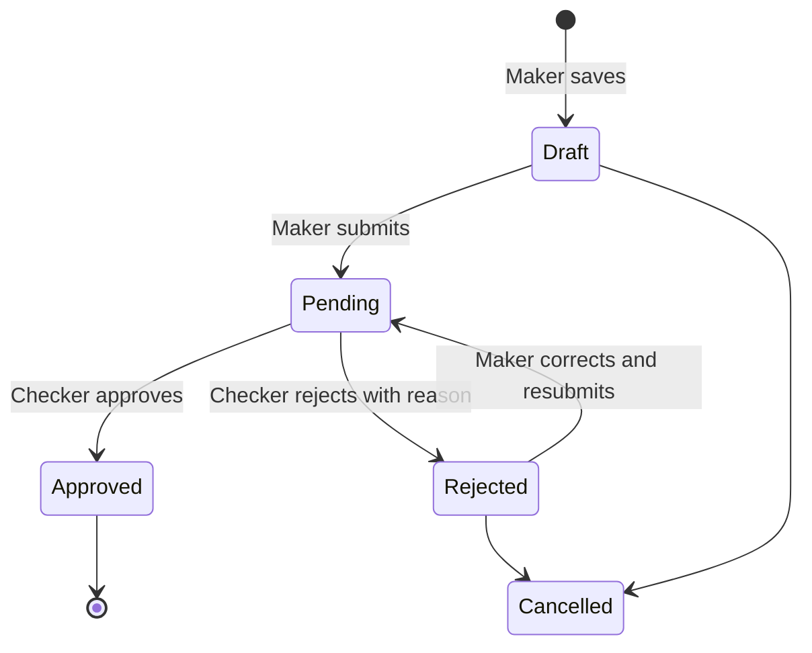

# Card Application Registration System

**A loan-origination module where bank staff capture, validate and approve card applications across 100+ fields, with field-level permissions per role, maker-checker approval and a full audit trail.**

> **About this repository**
> This project was built in a professional setting and its source code is the property of my employer. This repository is a **portfolio write-up only**: it contains no source code, no client data and no internal system details. Names, figures and workflows are described at a general level.

---

## Overview

Before a bank can issue a card, an application has to be captured, checked and approved. The data must then match, field for field, the fixed-format file that the card-management system uses to create the card. That file specification defines every field: which screen it belongs to, its label, data type, length and position.

I designed and built this system **from scratch**, starting from the file specification and a short scope statement. The application form is not hand-coded. It is generated from metadata, so the screens, the validation rules, the database schema and the documentation all come from one source and cannot drift apart.

## My Role

- Sole developer: requirements analysis, architecture, database design, back end, front end and tests.
- Turned a spreadsheet file specification into a metadata model and a code generator that drives the whole application.
- Designed the permission model (screen, tab and field level) and the maker-checker workflow.
- Built the UI design system, including a dark theme, and iterated on it with stakeholder feedback.
- Wrote the functional specification document shared with the client for sign-off.

## Key Features

**Metadata-driven application form**
- 100+ fields organised into 13 sections that mirror the card-management file specification.
- Each field renders as the right control (text, number, amount, date, yes/no, lookup list) from its metadata.
- The same metadata produces the client-side rules and the server-side validation, so both always agree.
- Draft mode saves incomplete work; submit mode enforces every mandatory field and format.
- Errors are shown beside the field, counted per section and listed in a summary that jumps to the field.

**Role-based access at three levels**
- Screens, form sections and individual fields are granted per role by an administrator, with no code change.
- Each field follows a cascade: enabled, visible, editable, mandatory. Anything not granted is hidden by default.
- Read-only fields are displayed disabled, and the server ignores posted values for fields the user may not edit.

**Maker-checker workflow**
- A maker enters and submits; a different user approves or rejects with a mandatory reason.
- Rejected requests return to the maker for correction and resubmission, with each cycle kept in a history timeline.
- Changes to an approved record go through a new edit request, and the checker sees a field-by-field comparison.
- Optimistic concurrency prevents two users from deciding or editing the same request at once.

**Audit and administration**
- Login audit (success, failure, lockout, timeout), administrative change audit with before and after snapshots, and versioned data history written by database triggers.
- User, role, permission, lookup-value and field-presentation administration screens.
- Session tracking with an idle timeout warning, forced password change and account lockout.

## Tech Stack

| Area | Technology |
|---|---|
| Back end | .NET 10, ASP.NET Core MVC, C# |
| Data access | Dapper, Microsoft.Data.SqlClient, stored procedures, table-valued parameters |
| Database | Microsoft SQL Server (triggers, filtered unique indexes, row versioning) |
| Front end | Razor views, Bootstrap 5.3, Bootstrap Icons, jQuery Validation, vanilla JavaScript |
| Security | Cookie authentication, PBKDF2 password hashing, anti-forgery tokens, strict Content Security Policy |
| Logging | Serilog |
| Testing | xUnit |
| Tooling | Node.js code and document generators |

## Architecture

- **Single source of truth.** One generator reads the specification and emits the metadata, the entity class, the SQL schema fragments and the documentation catalogue. Parity tests fail the build if any of them disagree.
- **Layered solution.** A core library holds the domain, validation and permission logic with no web or database dependency, which keeps it fully unit-testable. The web project holds controllers, views and data access.
- **Deny by default.** A global filter requires every controller action to declare the screen permission it needs, and a start-up check refuses to run if any action is unclassified.
- **No full ORM.** Data access uses hand-written SQL through Dapper and stored procedures for the workflow transitions, so every state change is one atomic database call.

## Request Lifecycle

## Engineering Highlights

- **Generating instead of hand-writing.** With over a hundred fields, hand-coding forms, validation and schema would have meant four copies of the same facts. The generator made regrouping every field onto different screens a configuration change rather than a rewrite.
- **Validation that cannot be bypassed.** The server validates from metadata rather than from what was posted, so removing a field from the request does not skip its rules.
- **Working without a local database.** Development happened on a locked-down machine with no database access. I kept business logic in a database-free core covered by unit tests, and delivered all schema changes as reviewed scripts for the server.
- **Strict browser security.** The Content Security Policy forbids inline scripts, so all behaviour is wired through data attributes and external files, and all fonts and libraries are self-hosted for offline bank networks.
- **A design system, not a theme.** Colour, spacing and typography are defined as tokens over Bootstrap, giving a consistent light and dark mode, toast notifications, confirmation dialogs and a responsive layout.

## Skills Demonstrated

`ASP.NET Core MVC` · `C#` · `.NET 10` · `SQL Server` · `Dapper` · `Stored procedures` · `Metadata-driven design` · `Code generation` · `Role-based access control` · `Field-level security` · `Maker-checker workflow` · `Audit logging` · `Optimistic concurrency` · `Unit testing` · `Content Security Policy` · `UI design systems` · `Requirements analysis` · `Technical writing` · `Banking domain`

---

**Sarim Nadeem** · MSc Computer Science · [LinkedIn](https://www.linkedin.com/in/msarimnadeem) · [GitHub](https://github.com/Sarim375)

*Source code is proprietary and not available. Happy to discuss the design and engineering decisions in an interview.*
